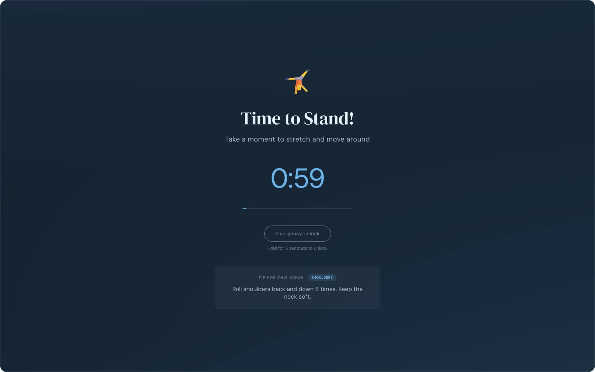
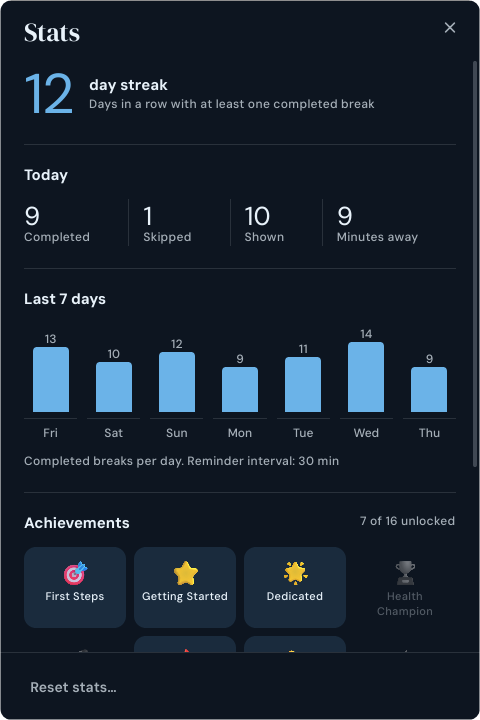
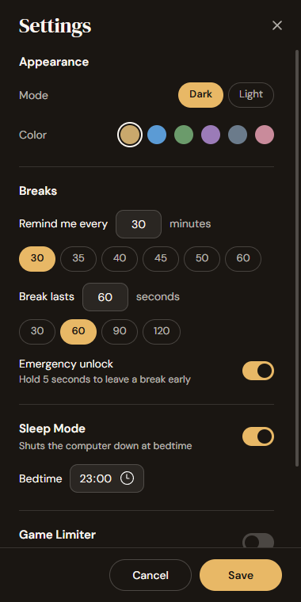
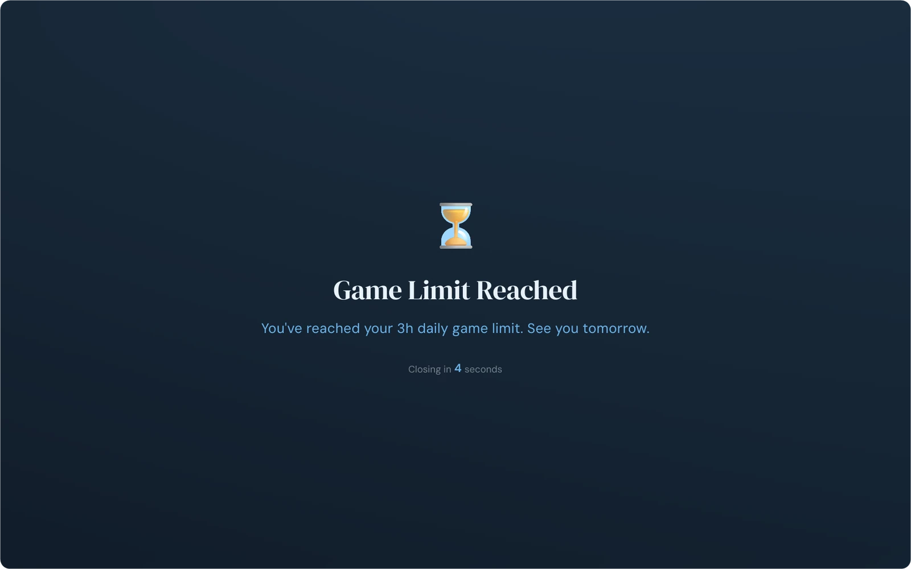

<h1 align="center">StandBuddy</h1>
<p align="center">
  A Windows tray app that makes you stand up every half hour, sends you to bed on time and caps your daily gaming.
</p>
<p align="center">
  <a href="https://github.com/bgtvdm/StandBuddy/releases/latest"><b>Download</b></a> ·
  <a href="#install">Install</a> ·
  <a href="#how-it-works">How it works</a>
</p>
<p align="center">
  <a href="https://github.com/bgtvdm/StandBuddy/releases/latest"></a>
  
  <a href="LICENSE"></a>
</p>



When a break is due, StandBuddy covers the whole screen until the countdown ends. No snooze button, no "remind me later". The only way out early is holding Emergency Unlock for five seconds, and that gets counted. You can switch that exit off in Settings.

- **Breaks that happen.** Every 30 minutes by default, 60 seconds of standing, a short movement tip each time.
- **A bedtime that holds.** Warnings at 30, 15 and 5 minutes, then a shutdown prompt with three snoozes at most.
- **A gaming budget.** One daily limit shared across all your games. When it runs out, the game closes.
- **Private.** No account, no cloud. Stats live in a JSON file on your machine.
- **Light.** About 11 MB of memory and 0% CPU while it waits in the tray. One process, no browser engine.

### Stats: streaks, the last 7 days and 16 achievements

<p align="center">
  
</p>

### Settings: look, interval, break length, sleep mode, games (here in light mode)

<p align="center">
  
</p>

### Game limit: the budget is spent



## Install

### With an AI agent

Paste this into Claude Code, Codex or any agent that can run PowerShell on your PC:

```text
Install StandBuddy (https://github.com/bgtvdm/StandBuddy) on this Windows PC.
1. Get the latest release from https://api.github.com/repos/bgtvdm/StandBuddy/releases/latest
   and download the asset named StandBuddy_<version>_x64-setup.exe to a temp folder.
2. Run it silently, no admin rights needed: Start-Process -Wait <setup.exe> -ArgumentList '/S'
   It installs per user into %LOCALAPPDATA%\StandBuddy. For another folder add '/D=<dir>' as the
   last argument, unquoted. If an older StandBuddy is running, the installer closes it and
   upgrades in place; settings and stats in %APPDATA%\standbuddy are kept.
3. A silent install does not start the app, so start it: explorer.exe "<install dir>\standbuddy.exe"
4. Check that a standbuddy.exe process is running and tell me to look for the icon in the tray
   (it may sit under the ^ overflow arrow). Then tell me to right-click it → Settings to set the
   interval and turn on Launch at startup.
To update later, repeat steps 1–3 with the newer release.
```

If Windows SmartScreen stops the installer, the agent can't click past it; it will ask you to click **More info** → **Run anyway**.

### By hand

1. Download `StandBuddy_<version>_x64-setup.exe` from the [latest release](https://github.com/bgtvdm/StandBuddy/releases/latest).
2. Run it. If SmartScreen shows "Unknown publisher", click **More info** → **Run anyway** (the app isn't code-signed).
3. The installer needs no admin rights. It adds a Start menu shortcut and starts StandBuddy in the tray.
4. Right-click the tray icon → **Settings** to set the interval and turn on **Launch at startup**.

To update, run the newer installer. Settings and stats live in `%APPDATA%\standbuddy` and stay. To remove the app, use **Settings → Apps → Installed apps → StandBuddy → Uninstall**.

Coming from 1.x (the zip version)? Quit it from the tray, run the installer, then delete the old unzipped folder. The installer turns off the old version's autostart for you.

## How it works

- **Breaks.** A timer runs while you work. When it fires, a full-screen overlay stays on top of every window until the break ends. Right-click the tray icon to pause reminders.
- **Sleep mode.** Set a bedtime. StandBuddy warns you ahead of it, then asks to shut the computer down. You can snooze up to three times.
- **Game limiter.** Add games with a file picker or pick them from your Steam library. Play time adds up across all of them. Corner warnings show at 30 and 5 minutes left, and at zero the game process is closed, anti-cheat titles included. You can also pause break reminders while a game runs. The only way around the limit is turning it off in Settings.
- **Themes.** Six colors (Warm, Ocean, Forest, Lavender, Slate, Rose), each in dark and light.

## Built with

Rust and [Slint](https://slint.dev) with its software renderer. No browser engine, no WebView2, no Electron.

Measured on v3.0.2 (release build, Windows 11, private bytes, CPU as % of one core):

| State | Memory | CPU |
|---|---|---|
| Idle in the tray | 11 MB | 0% |
| Stats and Settings open | 16 MB | 0% |
| Break overlay up, two monitors (3440×1440 + 1440×2560) | 46 MB | a few % for the first seconds, then ~0% |

Stats and Settings appear about 20 ms after the click. The installer is 3.8 MB and the app is a single 8.3 MB exe. For comparison, the 2.x line ran on WebView2 and used 140–300 MB for each open window.

To build the installer: Rust (MSVC), the Windows SDK and [NSIS](https://nsis.sourceforge.io), then `pwsh installer/build.ps1`. The setup file lands in `dist/`.

<a href="https://slint.dev"></a>

## License

MIT — see [LICENSE](LICENSE). Slint is used under the [Slint Royalty-free License 2.0](https://github.com/slint-ui/slint/blob/master/LICENSES/LicenseRef-Slint-Royalty-free-2.0.md); the bundled DM Sans and DM Serif Display fonts are under the SIL Open Font License.
