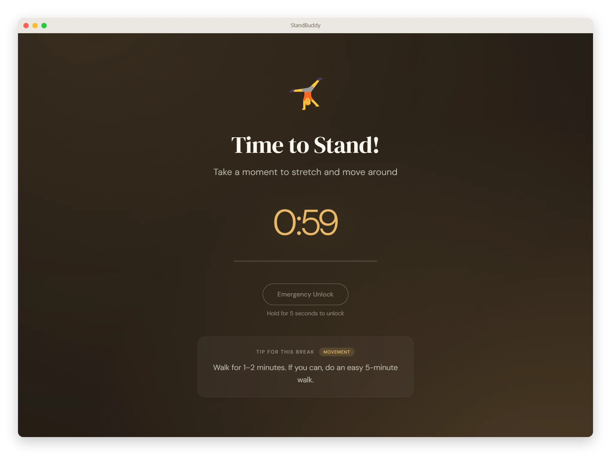
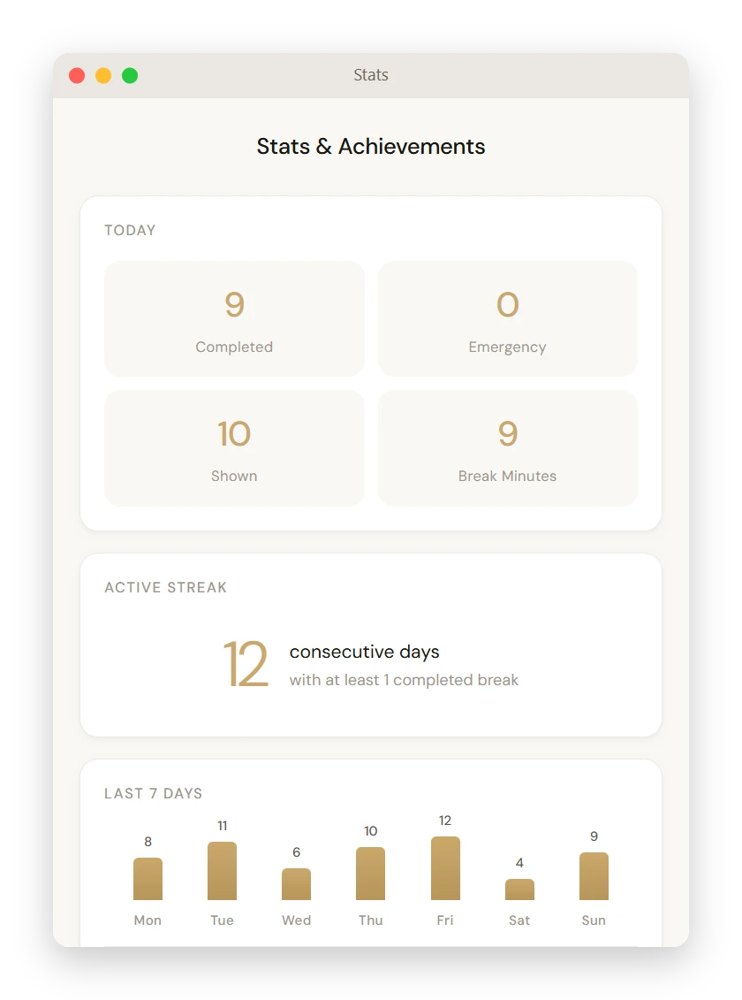
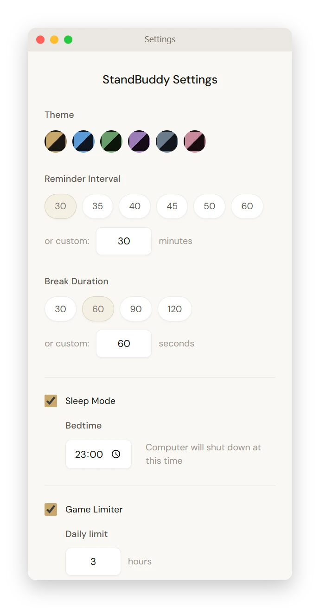
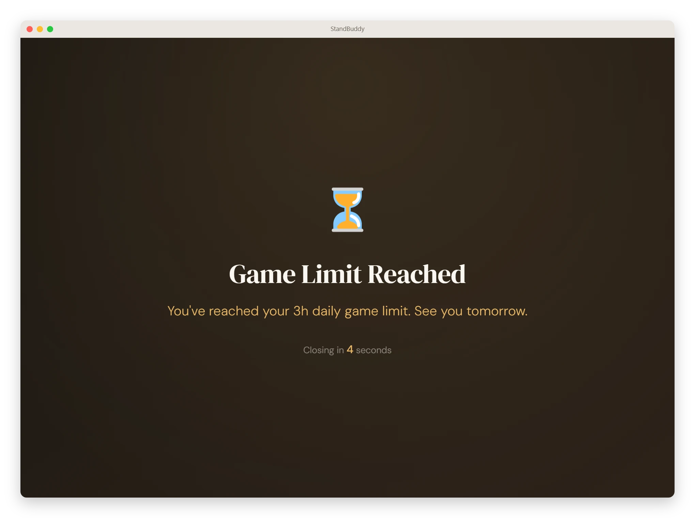

<h1 align="center">StandBuddy</h1>
<p align="center">
  A Windows tray app that makes you stand up every half hour, sends you to bed on time and caps your daily gaming.
</p>
<p align="center">
  <a href="https://github.com/bgtvdm/StandBuddy/releases/latest"><b>Download</b></a> ·
  <a href="#install">Install</a> ·
  <a href="#how-it-works">How it works</a>
</p>
<p align="center">
  <a href="https://github.com/bgtvdm/StandBuddy/releases/latest"></a>
  
  <a href="LICENSE"></a>
</p>



When a break is due, StandBuddy covers the whole screen until the countdown ends. No snooze button, no "remind me later". The only way out early is holding Emergency Unlock for five seconds, and that gets counted.

- **Breaks that happen.** Every 30 minutes by default, 60 seconds of standing, a short movement tip each time.
- **A bedtime that holds.** Warnings at 30, 15 and 5 minutes, then a shutdown prompt with three snoozes at most.
- **A gaming budget.** One daily limit shared across all your games. When it runs out, the game closes.
- **Private.** No account, no cloud. Stats live in a JSON file on your machine.

### Stats: streaks, the last 7 days and 16 achievements

<p align="center">
  
</p>

### Settings: interval, break length, sleep mode, games

<p align="center">
  
</p>

### Game limit: the budget is spent



## Install

StandBuddy ships as a Windows zip, there is no installer.

### With an AI agent

Paste this into Claude Code, Codex, Hermes or any agent that can run commands on your computer:

```text
Install StandBuddy from https://github.com/bgtvdm/StandBuddy.
1. Download the StandBuddy-*-win.zip asset of the latest release
   (https://api.github.com/repos/bgtvdm/StandBuddy/releases/latest).
2. Quit StandBuddy if it is running (tray icon → Quit).
3. Extract the zip into %LOCALAPPDATA%\Programs\StandBuddy, overwriting files
   in place if it is already there. Settings and stats live elsewhere and stay.
4. Start StandBuddy.exe from that folder and check that the tray icon appears.
5. If Windows SmartScreen blocks it, tell me to click "More info" → "Run anyway".
```

SmartScreen asks once because the app isn't code-signed. That click is yours.

### By hand

1. Download `StandBuddy-<version>-win.zip` from the [latest release](https://github.com/bgtvdm/StandBuddy/releases/latest).
2. Extract it to a folder you'll keep, for example `%LOCALAPPDATA%\Programs\StandBuddy`.
3. Run `StandBuddy.exe`. If SmartScreen shows "Unknown publisher", click **More info** → **Run anyway**.
4. Right-click the tray icon → **Settings** to set the interval and turn on **Launch at startup**.

To update, quit StandBuddy, extract the new zip over the same folder and start it again.

## How it works

- **Breaks.** A timer runs while you work. When it fires, a full-screen overlay stays on top of every window until the break ends. Right-click the tray icon to pause reminders.
- **Sleep mode.** Set a bedtime. StandBuddy warns you ahead of it, then asks to shut the computer down. You can snooze up to three times.
- **Game limiter.** Add games with a file picker or pick them from your Steam library. Play time adds up across all of them. Corner warnings show at 30 and 5 minutes left, and at zero the game process is closed, anti-cheat titles included. You can also pause break reminders while a game runs. The only way around the limit is turning it off in Settings.
- **Themes.** Six palettes: Warm, Ocean, Forest, Lavender, Slate, Rose.

## License

MIT — see [LICENSE](LICENSE).
